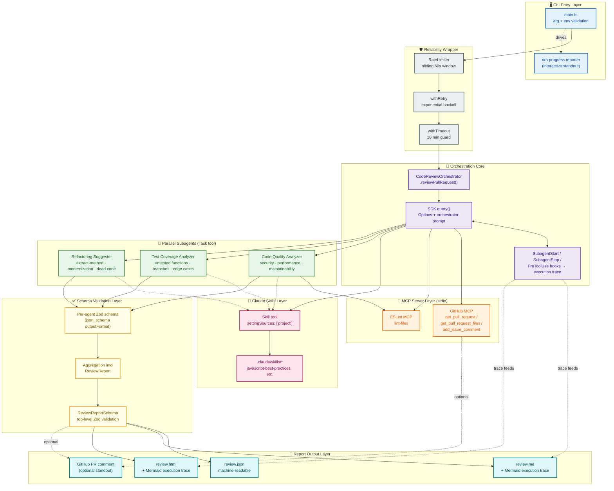

# Enterprise Multi-Agent Code Review Orchestrator

A production-grade TypeScript application, built on **Anthropic's Claude Agent SDK**, that automates pull request review by coordinating three specialized AI subagents under a single orchestrating agent. It fetches live pull request data from GitHub, runs parallel domain-specific analysis, validates every response against a strict schema, and publishes the aggregated findings as JSON, Markdown, and HTML reports.

[](#prerequisites)
[](#tech-stack)
[](#testing)
[](#architecture)

---

## Table of Contents

1. [Overview](#overview)
2. [Key Features](#key-features)
3. [Architecture](#architecture)
4. [Project Structure](#project-structure)
5. [Prerequisites](#prerequisites)
6. [Installation](#installation)
7. [Configuration](#configuration)
8. [Usage](#usage)
9. [Reports](#reports)
10. [Testing](#testing)
11. [Reliability & Operations](#reliability--operations)
12. [Claude Skills](#claude-skills)
13. [Standout Features](#standout-features)
14. [Results Snapshot](#results-snapshot)
15. [Limitations](#limitations)
16. [Tech Stack](#tech-stack)
17. [License](#license)

---

## Overview

Manual code review does not scale cleanly with team size or release velocity — review quality tends to track reviewer fatigue and calendar pressure rather than the actual risk of a change. This project closes that gap by applying **three distinct analytical lenses** to every changed file in a pull request, consistently and unattended:

- **Security & code quality** — vulnerabilities, performance problems, maintainability issues
- **Test coverage** — untested functions, branches, and edge cases
- **Refactoring opportunities** — extract-method/class candidates, modernization, dead code

A single orchestrating agent (`src/orchestrator.ts`) calls the Claude Agent SDK's `query()` function, retrieves PR metadata and file diffs through a GitHub MCP server, and explicitly delegates each selected file to all three subagents via the SDK's built-in `Task` tool. Every subagent response — and the final aggregated report — is validated against a Zod schema before it's ever written to disk, so downstream tooling can treat the model's output as reliably-typed data rather than free text.

## Key Features

- 🧠 **Multi-agent orchestration** — one coordinator, three purpose-built subagents, each scoped to a single concern
- 🔌 **MCP integration** — GitHub (PR/file/comment operations) and ESLint (automated linting), both launched as managed `stdio` child processes
- ✅ **Schema-first outputs** — every agent response is constrained by a JSON Schema generated from Zod, then re-validated at the aggregate level
- 📊 **Three report formats** — JSON (machine-readable), Markdown (PR comments/docs), HTML (shareable, styled)
- 🔁 **Production-grade reliability** — sliding-window rate limiter, exponential-backoff retries, per-run timeout guard
- 🖥️ **Interactive CLI** — live `ora` spinner progress as each subagent starts and finishes
- 🧵 **Agent execution traces** — every tool call and subagent lifecycle event is captured via SDK hooks and rendered as an embedded Mermaid.js sequence diagram in each report
- 💬 **Automated PR commenting** — optionally posts the review summary back to the pull request
- 🧪 **Golden-dataset regression suite** — exercises the Code Quality Analyzer against known SQL-injection, hardcoded-secret, and XSS fixtures to catch prompt regressions
- 🧩 **Claude Skills integration** — subagents invoke reusable, versioned skills for language- and domain-specific expertise

## Architecture

The system follows a layered orchestration architecture: a single top-level agent coordinates two categories of external capability — **Model Context Protocol (MCP) servers** and **Claude Skills** — and delegates domain-specific analysis to three parallel subagents through the SDK's `Task` tool.

Two decisions shape everything downstream:

- **Schema-first communication.** Subagents are never asked to "return some JSON" informally — they're constrained by `outputFormat: { type: 'json_schema' }`, derived mechanically from the project's Zod definitions via `zod-to-json-schema`. A malformed response is a validation failure the orchestrator can detect, not a silent data-quality problem three steps downstream.
- **No shared/global state.** Each `CodeReviewOrchestrator` instance owns its own rate limiter, execution-trace buffer, and progress callback, keeping repeated invocations (e.g. reviewing several PRs in one process) free of cross-contamination.

The diagram below traces the full data flow, from CLI invocation through orchestration, delegation, validation, and report generation. Each functional layer is color-coded as its own node group.



**Legend:** 🔵 CLI entry · 🟣 orchestration core · 🟠 MCP servers · 🌸 Claude Skills · 🟢 subagents · 🟡 schema validation · ⬜ reliability wrapper · 🩵 report outputs.

### Component Responsibility Matrix

| Component | Primary File | Responsibility |
|---|---|---|
| CLI Entry Point | `src/main.ts` | Argument/env validation, progress UI, report writing |
| Orchestrator | `src/orchestrator.ts` | SDK `query()` invocation, aggregation, validation |
| Subagents (×3) | `src/agents/*.ts` | Domain-specific analysis via `Task` tool delegation |
| Prompts | `src/prompts/*.ts` | Instructional content for orchestrator and subagents |
| MCP Config | `src/config/mcp.config.ts` | GitHub and ESLint server definitions |
| Type/Schema Layer | `src/types/*.ts` | Zod schemas and derived JSON Schemas |
| Error Handling | `src/utils/error-handler.ts` | `withRetry`, `withTimeout`, `ReviewError` |
| Rate Limiter | `src/utils/rate-limiter.ts` | Sliding-window request/token/concurrency control |
| Execution Trace | `src/utils/execution-trace.ts` | Hook-captured trace → Mermaid.js diagram |
| Report Generator | `src/utils/report-generator.ts` | JSON/Markdown/HTML rendering |

## Project Structure

```
submission/
├── src/
│   ├── main.ts                  # CLI entry point
│   ├── orchestrator.ts          # CodeReviewOrchestrator (core coordination logic)
│   ├── agents/                  # AgentDefinition for each subagent
│   │   ├── code-quality-analyzer.ts
│   │   ├── test-coverage-analyzer.ts
│   │   └── refactoring-suggester.ts
│   ├── prompts/                 # Prompt content for orchestrator + each subagent
│   ├── config/
│   │   └── mcp.config.ts        # GitHub + ESLint MCP server definitions
│   ├── types/                   # Zod schemas + derived JSON Schemas
│   └── utils/                   # Logger, rate limiter, error handler, trace, report generator
├── tests/
│   ├── orchestrator.test.ts     # Orchestrator behavior (mocked SDK)
│   ├── schemas.test.ts          # Zod schema validation
│   ├── golden-dataset.test.ts   # Live regression suite (gated on RUN_GOLDEN_DATASET)
│   └── fixtures/golden-dataset/ # Known-vulnerable fixture files
├── .claude/skills/               # Claude Skills invoked by subagents
├── evidence/                     # Captured terminal transcripts from live runs
├── reports/                      # pr reviewed reports in html, json an md formats
├── doc/                          # project report
├── package.json
├── tsconfig.json
└── .env.example
```

## Prerequisites

- **Node.js 18+**
- **Anthropic API access** (provided in a Vocareum workspace, or your own key from [console.anthropic.com](https://console.anthropic.com/)) — or AWS Bedrock credentials
- A **GitHub Personal Access Token** (recommended — scopes: `repo`, `read:org`) for reliable, authenticated GitHub API access

## Installation

```bash
# From the project directory
npm install

# Copy and fill in environment variables
cp .env.example .env
```

## Configuration

Set the following in `.env` (see `.env.example` for the full template):

| Variable | Required | Purpose |
|---|---|---|
| `ANTHROPIC_API_KEY` | ✅ (or AWS creds) | Anthropic API authentication |
| `AWS_ACCESS_KEY_ID` / `AWS_SECRET_ACCESS_KEY` / `AWS_REGION` | Alternative to API key | AWS Bedrock authentication |
| `ANTHROPIC_MODEL` | ✅ | Model ID (e.g. `claude-sonnet-4-5-20250929`) |
| `GITHUB_TOKEN` | Recommended | GitHub PAT — mapped internally to `GITHUB_PERSONAL_ACCESS_TOKEN` for the GitHub MCP server |
| `POST_PR_COMMENT` | Optional | Set to `true` to enable the automated PR-commenting standout |

`main.ts` validates all required arguments and environment variables **before spending a single API call**, and fails fast with a clear message if anything is missing.

## Usage

```bash
npm run dev -- <owner> <repo> <pr-number>

# Example
npm run dev -- octocat Hello-World 1
```

This will:
1. Validate CLI arguments and authentication
2. Spin up the orchestrator, which retrieves PR data via the GitHub MCP server
3. Dispatch all three subagents against each selected changed file
4. Validate and aggregate every result into a single `ReviewReport`
5. Write `reports/<owner>_<repo>_<pr>.{json,md,html}`
6. Optionally post a summary comment back to the pull request (`POST_PR_COMMENT=true`)

Build and run the compiled output instead of `tsx`:

```bash
npm run build
npm start -- octocat Hello-World 1
```

## Reports

Every run produces three parallel formats in `reports/`:

- **`.json`** — machine-readable, validated against `ReviewReportSchema`
- **`.md`** — human-readable summary suitable for PR comments and documentation
- **`.html`** — styled, shareable artifact

Both the Markdown and HTML reports include an appended **🧭 Agent Execution Trace** section — a Mermaid.js sequence diagram built from the captured `SubagentStart` / `SubagentStop` / `PreToolUse` hook events, showing exactly which tools were called, by which agent, and in what order.

## Testing

```bash
npm test               # Full non-network suite (schemas + orchestrator, mocked SDK)
npm run test:watch     # Watch mode
npm run test:golden    # Golden-dataset regression suite against a live model
npm run lint           # tsc --noEmit
```

The default suite runs **36 tests** (5 additional golden-dataset tests are intentionally skipped unless `RUN_GOLDEN_DATASET=true` and live API credentials are present). The golden-dataset suite exercises the Code Quality Analyzer against deliberately vulnerable fixtures — a SQL injection, a hardcoded secret, and a cross-site scripting flaw — to catch silent prompt regressions.

## Reliability & Operations

- **Rate limiting** — `RateLimiter` tracks requests, tokens, and concurrency in a sliding 60-second window (defaults: 50 req/min, 100k tokens/min, 5 concurrent) to avoid throttling.
- **Retry logic** — `withRetry` applies exponential backoff with jitter for transient failures.
- **Timeout guard** — `withTimeout` (10-minute default) prevents a hung subagent from stalling a review indefinitely.
- **Structured error handling** — every failure surfaces as a typed `ReviewError` with a stable `code` (see `ErrorCodes`) and optional metadata, rather than an opaque stack trace.
- **Stateless orchestrator instances** — no global/module-level singletons, so the same process can safely review many PRs back-to-back.

## Claude Skills

Subagents invoke Claude Skills through the SDK's `Skill` tool (enabled via `settingSources: ['project']`, which makes the SDK discover `.claude/skills/` relative to `PROJECT_ROOT`). This keeps language- and domain-specific expertise reusable and independent of any single subagent's prompt — new skills can be added to `.claude/skills/` and immediately become available to every subagent without code changes.

## Standout Features

Beyond the core deliverables, this implementation includes:

| Standout | Description |
|---|---|
| 💬 Automated PR Commenting | Posts the review summary back to the originating pull request via `mcp__github__add_issue_comment` |
| 🖥️ Interactive CLI | Live `ora`-driven progress reporting as each subagent starts and finishes |
| 🧪 Golden-Dataset Regression Suite | Validates the Code Quality Analyzer against known SQL-injection, hardcoded-secret, and XSS fixtures |
| 🧭 Agent Execution Traces | Every tool call and subagent lifecycle event captured via hooks and rendered as an embedded Mermaid.js sequence diagram |

## Results Snapshot

The system has been run end-to-end against real pull requests with live Anthropic and GitHub credentials, producing all required report files (see `evidence/` for full transcripts):

| Pull Request | Files Analyzed | Overall Score | Critical Issues | High-Priority Test Gaps | Refactoring Opportunities |
|---|---|---|---|---|---|
| `airaamane/simple-todo-app` #1 | 3 | 15/100 | 7 | 14 | 12 |
| `airaamane/simple-todo-app` #2 | 0 * | 0 | 0 | 0 | 0 |
| `airaamane/simple-todo-app` #3 | 0 * | 0 | 0 | 0 | 0 |

\* PRs #2 and #3 returned zero analyzable files during the live run — the system handled this gracefully and still produced valid, schema-conformant reports rather than crashing (see [Limitations](#limitations)).

The golden-dataset regression suite was also executed live against the real model, with all four of its tests passing, and the Automated PR Commenting standout was confirmed to post a real summary comment to a pull request under review.

## Limitations

- **Sparse evidence on PR #2/#3.** Two of the three required pull requests returned zero analyzed files and a score of 0 during the live run. The system degraded gracefully rather than crashing, but most of the evidence for the subagents' actual analytical output currently rests on PR #1. Confirming what #2 and #3 actually changed — and substituting PRs with substantive diffs if needed — is a natural next step.
- **Timeout headroom is tight.** PR #1's measured duration (771.4s) exceeded the orchestrator's default single-attempt timeout (600s) while still completing successfully via the retry path — a good resilience signal, but a concrete indicator that `timeoutMs` should be raised (or `maxFiles` lowered) for larger, more complex PRs in production.
- **Model reliability is a hard floor.** A schema-invalid response is caught and surfaces as a `ReviewError`, but a schema-*valid* response that is substantively wrong (a missed vulnerability, a misjudged severity, a refactor that wouldn't actually compile) is not something the validation layer can detect — no amount of schema constraint eliminates this dependency, it only narrows where failures can occur.
- **Short-lived MCP processes.** Both MCP servers run as `npx`-launched `stdio` child processes for the duration of a single `query()` call, which keeps the deployment footprint minimal but adds process-startup latency to every run.
- **Bounded analysis depth.** `maxFiles` (default 5) caps how many changed files are analyzed in depth per PR, trading completeness for cost and latency on large diffs.

## Tech Stack

- **Runtime:** Node.js 18+, TypeScript (strict mode)
- **Agent orchestration:** `@anthropic-ai/claude-agent-sdk`
- **MCP:** `@modelcontextprotocol/sdk`, `@modelcontextprotocol/server-github`, `@eslint/mcp`
- **Validation:** `zod`, `zod-to-json-schema`
- **Logging:** `winston`
- **CLI UX:** `ora`
- **Testing:** `vitest`

## License

ISC
